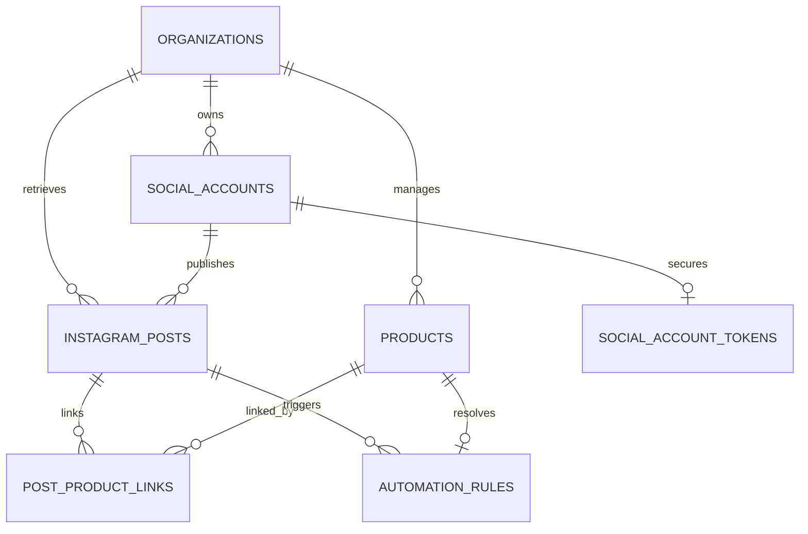

# Meta Instagram Integration & Comment-to-DM Checkout Architecture

## 1. Overview & Data Model Design

CommCart Step 5 establishes the foundation for Instagram account connection, post/Reels synchronization, post-to-product mapping, and keyword-triggered checkout automation rules.

### Entity Relationship Model



### Table Definitions & Roles

1. `social_accounts`:
   - Stores connected Instagram Professional account metadata (`organization_id`, `platform`, `external_account_id`, `username`, `connection_status`).
   - Protected by Row Level Security (RLS) ensuring strict organization isolation.
   - Enforces unique external accounts per platform and organization.

2. `social_account_tokens` (Server-Only Table):
   - Stores access tokens and expiry dates.
   - **Crucial Security Requirement:** RLS is enabled with zero permissions for `anon` and `authenticated` roles. Client queries cannot access tokens; only backend Express endpoints utilizing the server connection pool have read/write access.

3. `instagram_posts`:
   - Persists media items (`external_media_id`, `caption`, `media_type`, `media_url`, `permalink`, `thumbnail_url`, `published_at`).
   - Uniqueness enforced on `(social_account_id, external_media_id)` per connected account.

4. `post_product_links`:
   - Join table associating an Instagram post with one or more CommCart products.
   - Enforced by database trigger `check_post_product_link_org()` to guarantee cross-organization consistency (the post and product must belong to the exact same organization).

5. `automation_rules`:
   - Contains trigger rules with normalized uppercase keywords (`keywords TEXT[]`), match mode (`exact` vs `whole_word`), and enabled status (`is_enabled`).
   - Enforced by database trigger `check_automation_rule_org()` which validates:
     - All referenced accounts, posts, and products belong to the seller's organization.
     - **Ambiguity Conflict Prevention:** Prevents multiple enabled rules from registering overlapping keywords on the exact same post.

---

## 2. Meta Official APIs, Permissions & Setup

### Required Account Setup
1. **Instagram Account Type:** Must be switched to **Instagram Professional (Creator or Business)**. Personal Instagram accounts are not supported by the Meta Graph API.
2. **Facebook Page Link:** The Instagram account must be connected to a Facebook Page managed by the seller in Meta Business Suite.
3. **Meta Developer App:** Configured with the **Instagram Graph API** and **Webhooks** products.

### Required Permissions Scope
| Permission | Purpose |
| :--- | :--- |
| `instagram_basic` | Retrieve Instagram profile ID, username, and media list |
| `instagram_manage_comments` | Listen to comments on posts/reels and reply to comments |
| `instagram_manage_messages` | Send direct messages and Private Replies from the Instagram account |
| `pages_show_list` | Discover Facebook Pages connected to the user |
| `pages_read_engagement` | Read page metadata and link status |

---

## 3. Comment-to-DM Checkout: Meta Messaging Window Restrictions

Before promising automated private replies or multi-step checkout conversations over Instagram DMs, the following Meta API limitations and platform policies must be respected:

### A. Comment-Triggered Private Replies (The 7-Day / 1-Reply Rule)
- When a customer leaves a comment on an Instagram post (e.g. *"BUY"*), Meta allows the merchant account to send **one single Private Reply** directly to the commenter using the endpoint:
  ```http
  POST https://graph.facebook.com/v21.0/{comment-id}/replies
  Content-Type: application/json

  {
    "recipient": {
      "comment_id": "<COMMENT_ID>"
    },
    "message": {
      "text": "Thanks for your interest! Here is your checkout link for Nairobi Silk Dress: https://commcart.co/checkout/..."
    }
  }
  ```
- **Time Window:** The Private Reply must be sent within **7 days** of the comment creation timestamp.
- **Single Reply Limit:** Meta permits only **one** private reply per comment. Attempting to send a second private message for the same comment will result in an error (`(#100) You cannot send another private reply to this comment`).

### B. The 24-Hour Messaging Window Distinction
- **A Private Reply DOES NOT open an active 24-hour messaging window.**
- Sending a Private Reply sends a DM to the customer's inbox with a link referencing the original comment.
- If the customer **replies** to that DM, a standard **24-hour messaging window** is initiated.
- Within that 24-hour window, CommCart can exchange subsequent conversational messages (e.g., selecting size, color, confirming delivery address, or prompting M-Pesa STK push).
- **Outside the 24-hour window:**
  - Automated or conversational follow-up messages are strictly prohibited by Meta unless using approved message tags (e.g. `POST_PURCHASE_UPDATE` or `CONFIRMED_EVENT_UPDATE`) or the **Human Agent** tag (which extends the manual response window to 7 days for authorized human customer support).
  - Marketing or promotional messages cannot be sent outside the window.

### C. Recommended Customer Journey Architecture
1. **Comment Trigger:** Customer comments `BUY` on an Instagram Reel.
2. **Webhook Event:** CommCart receives `instagram_comments` webhook payload with `comment_id`, `media_id`, `text`, and `from.id`.
3. **Keyword Resolution:** CommCart normalizes comment text, finds enabled `automation_rules` for `media_id`, and resolves the linked `product_id`.
4. **Immediate Single Private Reply:** CommCart sends a Private Reply containing product details, price in KES, and a direct checkout link (`https://commcart.co/checkout/[session-id]`).
5. **Two-Way Conversation Initiation (Optional):** If the customer replies back in the DM thread (e.g., *"Is size 10 in stock?"*), the 24-hour messaging window unlocks, allowing conversational ordering.

---

## 4. Diagnostics & Live Environment Status

When testing with the configured environment credentials in `.env.local`:
- `META_APP_ID`: `1705340041161659`
- `INSTAGRAM_PAGE_ID`: `1115581054556995`
- `INSTAGRAM_PAGE_ACCESS_TOKEN`: Configured
- **Meta Graph API Diagnostic Result:**
  ```json
  {
    "error": {
      "message": "Error validating access token: Session has expired. The current time is Tuesday, 27-Oct-26.",
      "type": "OAuthException",
      "code": 190,
      "error_subcode": 463
    }
  }
  ```
- **Graceful Handling:**
  - The CommCart application does **not** fabricate accounts or invent synthetic posts.
  - When Meta responds with `code: 190`, CommCart's UI displays a clear, actionable diagnostic alert with setup guidance to renew the Page Access Token via Meta for Developers (Graph API Explorer) or re-authenticate via OAuth.
  - When valid credentials or refreshed tokens are supplied, the server automatically queries official Meta endpoints and upserts real posts and Reels.
